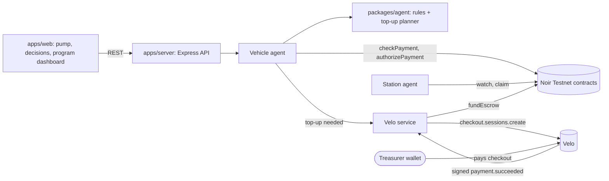
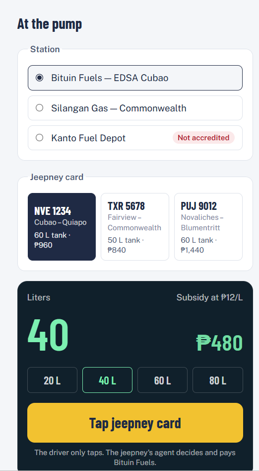
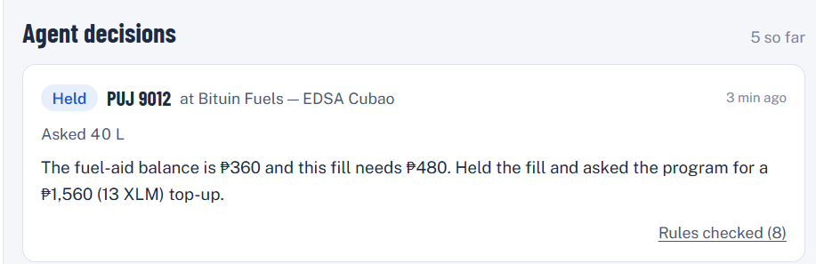
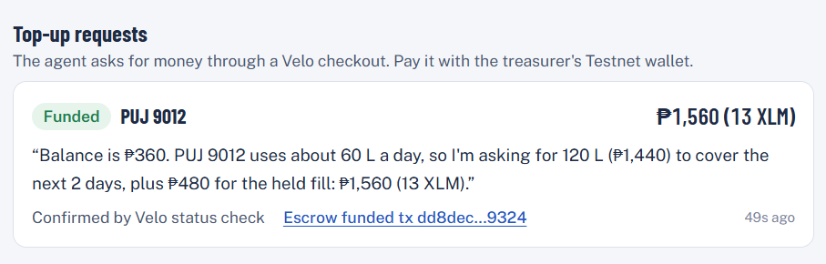

# Pasada

Fuel aid that only buys fuel: each jeepney's card gets a Noir escrow run by its own AI agent, which decides every fill, pays the station on the spot, and asks the program for a top-up through Velo when it runs low. Built for programs that give fuel aid to public utility vehicle (PUV) drivers.

**Live website:** https://pasada-eosin.vercel.app (API: https://pasada-server.onrender.com/api/health; free Render instance, first load after idle can take ~30 s)
**Demo video (2 min):** https://TODO
**Pitch deck:** https://TODO
**Team:** Christian Angelo Naguio (Discord `trixtaos`), Neil Aldous Biason (Discord `_r1tsuuu`)

## Problem

The Philippine government keeps funding fuel aid for jeepney drivers, most recently a ₱10–₱12 per-liter discount in 2026 capped at 150 liters per vehicle a week, and every delivery channel breaks. Stations front the discount and wait for reimbursement, and some stopped honoring it; cash and ATM cards get spent on things other than fuel; and payout events make drivers queue and lose trips. The rules are only checked after the money has moved. ([sources](docs/01-product-context.md#1-the-problem-why-this-is-real-not-a-one-off))

## Solution

Pasada puts the rules inside the money. The program registers each jeepney's NFC card on Noir, gives the jeepney's agent a constrained key (a per-fill cap and an expiry), and funds its escrow. At the pump, the driver only taps the card. The vehicle agent decides whether and how much to pay, pays the station through Noir's escrow, and a station agent claims the payment. When the escrow runs low, the agent sizes a top-up from its own usage and requests it from the program through a Velo checkout; Velo's signed confirmation triggers the escrow refill.

## How the agentic payment works

1. **Driver taps** the jeepney's card at a pump and enters the liters (`POST /api/fills`).
2. **The vehicle agent decides** (pure rules in [`rules.ts`](packages/agent/src/rules.ts)): the station must be accredited; the fill is capped at the tank size and the remaining 150 L weekly allowance; a second fill within an hour that would overfill the tank is **held** for program review.
3. **It checks Noir** with `checkPayment` (the contract's own `check_payment` plus the escrow balance).
4. **It pays** with `authorizePayment` from the jeepney's escrow to the station (whom), for the capped amount (how much), now or later (when).
5. **The station agent claims**: it watches `payment.authorized` events and calls `claim`.
6. **When funds run short, the agent requests money**: it holds the fill, works out the top-up (two days of its own usage plus the held fill, minus the balance), and creates a **Velo checkout session** for the program treasurer.
7. **Velo confirms** the payment on the ledger and sends a signed `payment.succeeded` webhook (a status poller is the backup). The server calls Noir `fundEscrow`, and the held fill is paid automatically.

## Architecture



## Noir integration

- **SDK:** `@noirx402/agent-sdk@0.3.0`, default `TESTNET` contracts (no override).
- **Contracts called:** `device_registry` (`CAC4…QHU5`), `agent_registry` (`CCMZ…EBV`), `payment_escrow` (`CC7E…BFS`).
- **Client:** `new NoirAgentClient()` with no network override — [`noirChain.ts#L27`](packages/agent/src/noirChain.ts#L27).
- **Methods used:**

| Method | Where | Why |
| --- | --- | --- |
| `execute({ kind: 'registerDevice' })` | [`noirChain.ts#L63`](packages/agent/src/noirChain.ts#L63), run by [`setup-chain.ts`](apps/server/scripts/setup-chain.ts) | Link each jeepney card to the program wallet and its agent |
| `execute({ kind: 'registerAgent' })` | [`noirChain.ts#L71`](packages/agent/src/noirChain.ts#L71) | Per-fill cap = tank × subsidy rate; expiry = program end |
| `execute({ kind: 'fundEscrow' })` | [`noirChain.ts#L84`](packages/agent/src/noirChain.ts#L84), called after Velo confirms a top-up in [`topups.ts#L110`](apps/server/src/velo/topups.ts#L110) | Initial funding and every Velo-confirmed top-up |
| `checkPayment` | [`noirChain.ts#L56`](packages/agent/src/noirChain.ts#L56), used by the agent in [`vehicleAgent.ts#L124`](packages/agent/src/vehicleAgent.ts#L124) | The agent's pre-payment check |
| `authorizePayment` | [`noirChain.ts#L105`](packages/agent/src/noirChain.ts#L105), used in [`vehicleAgent.ts#L145`](packages/agent/src/vehicleAgent.ts#L145) | The agent pays the station |
| `claim`, `getPendingBalance`, `watch` | [`noirChain.ts#L112`](packages/agent/src/noirChain.ts#L112), [`stationAgent.ts#L27`](packages/agent/src/stationAgent.ts#L27), [`stationAgent.ts#L55`](packages/agent/src/stationAgent.ts#L55) | Station agent collects payments |
| `getEscrowBalance`, `getPolicy` | [`noirChain.ts#L48`](packages/agent/src/noirChain.ts#L48), [`vehicleAgent.ts#L169`](packages/agent/src/vehicleAgent.ts#L169) | Low-balance detection (the agent then requests money) and the dashboard |

## Velo integration

- **SDK:** `@carts1024/velo-sdk@0.1.0-alpha.4`.
- **What Velo does:** the vehicle agent's top-up requests (checkout sessions), payment status (`paymentIntents.retrieve` poller), and signed `payment.succeeded` webhooks that trigger the Noir escrow refill.
- **Files:**
  - `new Velo(...)` and `checkout.sessions.create` — [`velo/client.ts#L45-L51`](apps/server/src/velo/client.ts#L45-L51)
  - `paymentIntents.retrieve` (status poller) — [`velo/client.ts#L67`](apps/server/src/velo/client.ts#L67), [`velo/poller.ts#L14`](apps/server/src/velo/poller.ts#L14)
  - `Velo.webhooks.verify` on the raw body — [`routes/veloWebhook.ts#L27`](apps/server/src/routes/veloWebhook.ts#L27). The dashboard sends a flatter body than the SDK's types expect, so after the SDK has matched the HMAC we read the intent id ourselves and confirm amount and status with `paymentIntents.retrieve` ([`#L64`](apps/server/src/routes/veloWebhook.ts#L64)); see [`docs/DEVLOG.md`](docs/DEVLOG.md).
  - The agent's top-up request and the escrow refill after payment — [`velo/topups.ts`](apps/server/src/velo/topups.ts)

## Testnet proof

All from the **live site**, Stellar Testnet. Full log (setup, smoke test, local and live runs): [`docs/testnet-proof.md`](docs/testnet-proof.md).

- Agent payment (`authorize`, S1: 40 L, 4 XLM to Bituin Fuels): https://stellar.expert/explorer/testnet/tx/a7d217fc67d3f4d9048c614aa832a836f85ad0633cd9fb1f3c286d7b404d88e3
- Station claim (S1): https://stellar.expert/explorer/testnet/tx/f2f0c3e0ae521e231aa4649fc7377ac31acce0911c6f1bb554aab6d83f6ae214
- Capped payment (S2: asked 80 L, tank holds 50 L): https://stellar.expert/explorer/testnet/tx/58371148ada9c3408e8933b21d22254db3448df593c3492a186c0db0982ace4b
- Escrow top-up after a Velo payment (`fundEscrow`, S5: 13 XLM, Velo checkout confirmed by signed webhook): https://stellar.expert/explorer/testnet/tx/d4db905641a5b8e61116aa14f8664fc5a4ee80695be64262d73c4e11f1d50b22
- The held fill paid automatically once the funds arrived (S5): https://stellar.expert/explorer/testnet/tx/3fdfd925663486c813d25864363fc7b0f46cdd6c1c06a8be2e8db74241c7c67c

## Repo structure

```
apps/web/          the live website (Vite + React)
apps/server/       API, Velo checkout/webhook/poller, agent runtime, setup scripts
packages/agent/    vehicle agent, station agent, rules, top-up planner, every Noir SDK call
packages/shared/   types, demo program config, money formatting
docs/              design docs, testnet proof, screenshots
```

## Run it locally

1. Prerequisites: Node ≥ 22.23.4 (or ≥ 24.22.1); a Velo Testnet API key and webhook secret from velo-build.dev; a Testnet wallet (e.g. the Noir Chrome extension) to act as the treasurer.
2. `npm install` at the root.
3. `cp apps/server/.env.example apps/server/.env` and `cp apps/web/.env.example apps/web/.env`; fill `VELO_API_KEY`, `VELO_WEBHOOK_SECRET`, `ADMIN_TOKEN`; then `npm run keys` (creates and funds the Testnet accounts) and `npm run setup:chain` (registers the demo jeepneys on Noir).
   In the Velo console, a new project must be **registered on-chain** and **Velo Pay activated** before checkouts work (otherwise the API returns 401 "Payment access not activated"). `npx tsx apps/server/scripts/velo-check.ts` creates a 1 XLM test checkout to confirm.
4. `npm run dev` → open http://localhost:5173.
5. Optional offline mode (no Stellar, no Velo): `npm run dev:fake` runs the same agents against an in-memory chain and a local test checkout. It is only for UI work; the live site always runs on Testnet.
6. Tests: `npm test` (rule engine, top-up planner, vehicle agent against a fake chain).

## Environment variables

| Name | What it is | Where to get it |
| --- | --- | --- |
| `PROGRAM_OWNER_SECRET` | Program wallet that owns the cards and funds escrows | `npm run keys` |
| `AGENT_J1_SECRET`, `AGENT_J2_SECRET`, `AGENT_J3_SECRET` | Vehicle agent keys | `npm run keys` |
| `STATION_S1_SECRET`, `STATION_S2_SECRET` | Accredited station keys | `npm run keys` |
| `STATION_S3_PUBLIC` | Unaccredited station address | `npm run keys` |
| `VELO_API_KEY` | Velo Testnet API key | velo-build.dev |
| `VELO_WEBHOOK_SECRET` | Velo webhook signing secret | velo-build.dev → webhooks |
| `WEB_ORIGIN` | Allowed CORS origins | your web URL(s) |
| `PUBLIC_WEB_URL` | Where Velo checkout returns | your web URL |
| `ADMIN_TOKEN` | Protects admin routes | any random string |
| `VITE_API_URL` (web) | Server URL | your server URL |

## Screenshots

Taken from the live site.

| At the pump | Agent decisions | Velo top-up |
| --- | --- | --- |
|  |  |  |

## What's next

- Real NFC readers at the pump (the card already works by UID hash).
- A peso stablecoin instead of Testnet XLM, and same-day peso payout to stations.
- Pilot with a transport cooperative or LGU running its own fuel aid; then national programs.
- Fee sponsorship so drivers and stations never hold XLM.
- The same engine for private fleets (fuel, tolls and repairs per trip).

## Credits

- [Noir](https://github.com/noirx402/noir) and `@noirx402/agent-sdk` (contracts, SDK, Chrome extension).
- [Velo](https://github.com/Velo-Ecosystem-Collection/Velo) and `@carts1024/velo-sdk`.
- `@stellar/stellar-sdk`, Express, React, Vite, Tailwind CSS, Vitest.
- Problem research: news sources listed in [`docs/01-product-context.md`](docs/01-product-context.md).
