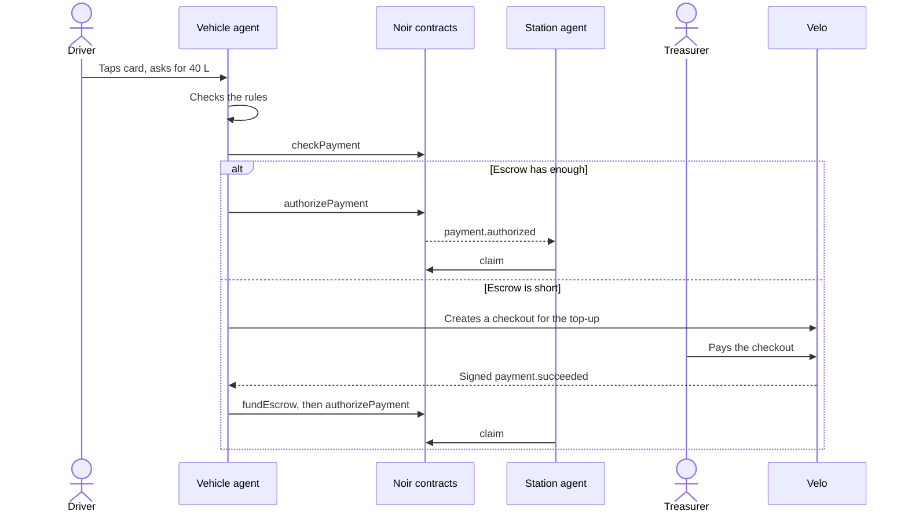

<p align="center">
  
</p>

<p align="center">
  <a href="https://pasada-eosin.vercel.app"></a>
  
  
  
</p>

<p align="center"><b>A Velo x Noir Agentic Payment Hackathon entry</b></p>

**Live website:** https://pasada-eosin.vercel.app (API: https://pasada-server.onrender.com/api/health; free Render instance, first load after idle can take ~30 s)
**Demo video (2 min):** https://TODO
**Pitch deck:** https://TODO
**Team:** Christian Angelo Naguio (Discord `trixtaos`), Neil Aldous Biason (Discord `_r1tsuuu`)

> [!NOTE]
> Everything here runs on **Stellar Testnet** with Testnet XLM. No real funds move. Amounts use a demo rate of ₱120 = 1 XLM.

## Pasada in 30 seconds

Governments keep paying fuel aid to jeepney drivers, and the money keeps leaking, because the rules are only checked **after** it has moved.

Pasada moves the rules **into the money**. Each jeepney's card gets a Noir escrow run by its own AI agent. When the driver taps the card at a pump, the agent decides whether to pay, pays the station on the spot, and asks the program for more money when its route needs it. The driver never presses "Pay".

| The agent chooses | What that looks like |
| --- | --- |
| **Whom** | Only accredited stations. Anyone else is refused before the chain is touched. |
| **How much** | Capped at the tank size and the 150 L weekly allowance. It also sizes its own top-up requests. |
| **When** | Pays now, holds for program review, or holds until funds arrive. |

**On this page:** [Problem](#problem) · [Solution](#solution) · [How it works](#how-the-agentic-payment-works) · [See it yourself](#see-it-yourself) · [Architecture](#architecture) · [Noir](#noir-integration) · [Velo](#velo-integration) · [Testnet proof](#testnet-proof) · [Repo](#repo-structure) · [Run it](#run-it-locally) · [Env vars](#environment-variables) · [Screenshots](#screenshots) · [FAQ](#faq) · [Limits](#known-limits) · [What's next](#whats-next) · [Glossary](#glossary) · [Credits](#credits)


## Problem

The Philippine government keeps funding fuel aid for jeepney drivers, most recently a ₱10–₱12 per-liter discount in 2026 capped at 150 liters per vehicle a week, and every delivery channel breaks. ([sources](docs/01-product-context.md#1-the-problem-why-this-is-real-not-a-one-off))

| Channel | Breaks on | What goes wrong |
| --- | --- | --- |
| Discount at the pump | **Speed** | Stations front the discount and wait to be reimbursed; some stopped honoring it |
| Cash and ATM cards | **Purpose** | Money gets spent on things other than fuel |
| Cash payout events | **Access** | Drivers queue, lose trips, and some never claim |

## Solution

Pasada puts the rules inside the money. The program registers each jeepney's NFC card on Noir, gives the jeepney's agent a constrained key (a per-fill cap and an expiry), and funds its escrow. At the pump, the driver only taps the card. The vehicle agent decides whether and how much to pay, pays the station through Noir's escrow, and a station agent claims the payment. When the escrow runs low, the agent sizes a top-up from its own usage and requests it from the program through a Velo checkout; Velo's signed confirmation triggers the escrow refill.

| Who | What they need | What Pasada gives them |
| --- | --- | --- |
| **Driver** | Subsidy in the tank, no queues or paperwork | Tap the jeepney's card at an accredited pump |
| **Station** | Honor the subsidy and get paid fast | A station agent claims each payment automatically |
| **Program office** | Every peso becomes fuel, and proof of it | Rules enforced at payment, a live audit trail, top-ups only when needed |


## How the agentic payment works

1. **Driver taps** the jeepney's card at a pump and enters the liters (`POST /api/fills`).
2. **The vehicle agent decides** (pure rules in [`rules.ts`](packages/agent/src/rules.ts)): the station must be accredited; the fill is capped at the tank size and the remaining 150 L weekly allowance; a second fill within an hour that would overfill the tank is **held** for program review.
3. **It checks Noir** with `checkPayment` (the contract's own `check_payment` plus the escrow balance).
4. **It pays** with `authorizePayment` from the jeepney's escrow to the station (whom), for the capped amount (how much), now or later (when).
5. **The station agent claims**: it watches `payment.authorized` events and calls `claim`.
6. **When funds run short, the agent requests money**: it holds the fill, works out the top-up (two days of its own usage plus the held fill, minus the balance), and creates a **Velo checkout session** for the program treasurer.
7. **Velo confirms** the payment on the ledger and sends a signed `payment.succeeded` webhook (a status poller is the backup). The server calls Noir `fundEscrow`, and the held fill is paid automatically.



## See it yourself

Open the [live site](https://pasada-eosin.vercel.app) and try these. Each one is an acceptance test from [`docs/01-product-context.md`](docs/01-product-context.md#5-scenarios-these-are-the-acceptance-tests-run-them-in-this-order-on-a-fresh-setup). Live balances change as people use the site, so a run may not match exactly.

| Scenario | Try this | What the agent does |
| --- | --- | --- |
| **S1 Normal fill** | NVE 1234 at Bituin Fuels, 40 L | Pays ₱480 (4 XLM); the station agent claims it |
| **S2 Overfill** | TXR 5678 at Silangan Gas, 80 L | Pays for 50 L only, because the tank holds 50 L |
| **S3 Too soon** | NVE 1234 again within the hour, 30 L | Holds the fill for program review; no transaction |
| **S4 Not accredited** | TXR 5678 at Kanto Fuel Depot, 20 L | Refuses before any money moves |
| **S5 Asks for money** | PUJ 9012 at Bituin Fuels, 40 L, with 3 XLM in escrow | Holds the fill, requests a 13 XLM top-up through Velo, then pays once funded |


## Architecture


## Noir integration

- **SDK:** `@noirx402/agent-sdk@0.3.0`, default `TESTNET` contracts (no override).
- **Contracts called:** `device_registry` (`CAC4…QHU5`), `agent_registry` (`CCMZ…EBV`), `payment_escrow` (`CC7E…BFS`).
- **Client:** `new NoirAgentClient()` with no network override — [`noirChain.ts#L27`](packages/agent/src/noirChain.ts#L27).
- **Methods used:**

| Method | Where | Why |
| --- | --- | --- |
| `execute({ kind: 'registerDevice' })` | [`noirChain.ts#L63`](packages/agent/src/noirChain.ts#L63), run by [`setup-chain.ts`](apps/server/scripts/setup-chain.ts) | Link each jeepney card to the program wallet and its agent |
| `execute({ kind: 'registerAgent' })` | [`noirChain.ts#L71`](packages/agent/src/noirChain.ts#L71) | Per-fill cap = tank × subsidy rate; expiry = program end |
| `execute({ kind: 'fundEscrow' })` | [`noirChain.ts#L84`](packages/agent/src/noirChain.ts#L84), called after Velo confirms a top-up in [`topups.ts#L110`](apps/server/src/velo/topups.ts#L110) | Initial funding and every Velo-confirmed top-up |
| `checkPayment` | [`noirChain.ts#L56`](packages/agent/src/noirChain.ts#L56), used by the agent in [`vehicleAgent.ts#L124`](packages/agent/src/vehicleAgent.ts#L124) | The agent's pre-payment check |
| `authorizePayment` | [`noirChain.ts#L105`](packages/agent/src/noirChain.ts#L105), used in [`vehicleAgent.ts#L145`](packages/agent/src/vehicleAgent.ts#L145) | The agent pays the station |
| `claim`, `getPendingBalance`, `watch` | [`noirChain.ts#L112`](packages/agent/src/noirChain.ts#L112), [`stationAgent.ts#L27`](packages/agent/src/stationAgent.ts#L27), [`stationAgent.ts#L55`](packages/agent/src/stationAgent.ts#L55) | Station agent collects payments |
| `getEscrowBalance`, `getPolicy` | [`noirChain.ts#L48`](packages/agent/src/noirChain.ts#L48), [`vehicleAgent.ts#L169`](packages/agent/src/vehicleAgent.ts#L169) | Low-balance detection (the agent then requests money) and the dashboard |

## Velo integration

- **SDK:** `@carts1024/velo-sdk@0.1.0-alpha.4`.
- **What Velo does:** the vehicle agent's top-up requests (checkout sessions), payment status (`paymentIntents.retrieve` poller), and signed `payment.succeeded` webhooks that trigger the Noir escrow refill.
- **Files:**
  - `new Velo(...)` and `checkout.sessions.create` — [`velo/client.ts#L45-L51`](apps/server/src/velo/client.ts#L45-L51)
  - `paymentIntents.retrieve` (status poller) — [`velo/client.ts#L67`](apps/server/src/velo/client.ts#L67), [`velo/poller.ts#L14`](apps/server/src/velo/poller.ts#L14)
  - `Velo.webhooks.verify` on the raw body — [`routes/veloWebhook.ts#L27`](apps/server/src/routes/veloWebhook.ts#L27). The dashboard sends a flatter body than the SDK's types expect, so after the SDK has matched the HMAC we read the intent id ourselves and confirm amount and status with `paymentIntents.retrieve` ([`#L64`](apps/server/src/routes/veloWebhook.ts#L64)); see [`docs/DEVLOG.md`](docs/DEVLOG.md).
  - The agent's top-up request and the escrow refill after payment — [`velo/topups.ts`](apps/server/src/velo/topups.ts)


## Testnet proof

All from the **live site**, Stellar Testnet. Full log (setup, smoke test, local and live runs): [`docs/testnet-proof.md`](docs/testnet-proof.md).

- Agent payment (`authorize`, S1: 40 L, 4 XLM to Bituin Fuels): https://stellar.expert/explorer/testnet/tx/a7d217fc67d3f4d9048c614aa832a836f85ad0633cd9fb1f3c286d7b404d88e3
- Station claim (S1): https://stellar.expert/explorer/testnet/tx/f2f0c3e0ae521e231aa4649fc7377ac31acce0911c6f1bb554aab6d83f6ae214
- Capped payment (S2: asked 80 L, tank holds 50 L): https://stellar.expert/explorer/testnet/tx/58371148ada9c3408e8933b21d22254db3448df593c3492a186c0db0982ace4b
- Escrow top-up after a Velo payment (`fundEscrow`, S5: 13 XLM, Velo checkout confirmed by signed webhook): https://stellar.expert/explorer/testnet/tx/d4db905641a5b8e61116aa14f8664fc5a4ee80695be64262d73c4e11f1d50b22
- The held fill paid automatically once the funds arrived (S5): https://stellar.expert/explorer/testnet/tx/3fdfd925663486c813d25864363fc7b0f46cdd6c1c06a8be2e8db74241c7c67c

## Repo structure

```
apps/web/          the live website (Vite + React)
apps/server/       API, Velo checkout/webhook/poller, agent runtime, setup scripts
packages/agent/    vehicle agent, station agent, rules, top-up planner, every Noir SDK call
packages/shared/   types, demo program config, money formatting
docs/              design docs, testnet proof, screenshots
```


## Run it locally

1. Prerequisites: Node ≥ 22.23.4 (or ≥ 24.22.1); a Velo Testnet API key and webhook secret from velo-build.dev; a Testnet wallet (e.g. the Noir Chrome extension) to act as the treasurer.
2. `npm install` at the root.
3. `cp apps/server/.env.example apps/server/.env` and `cp apps/web/.env.example apps/web/.env`; fill `VELO_API_KEY`, `VELO_WEBHOOK_SECRET`, `ADMIN_TOKEN`; then `npm run keys` (creates and funds the Testnet accounts) and `npm run setup:chain` (registers the demo jeepneys on Noir).
   In the Velo console, a new project must be **registered on-chain** and **Velo Pay activated** before checkouts work (otherwise the API returns 401 "Payment access not activated"). `npx tsx apps/server/scripts/velo-check.ts` creates a 1 XLM test checkout to confirm.
4. `npm run dev` → open http://localhost:5173.
5. Optional offline mode (no Stellar, no Velo): `npm run dev:fake` runs the same agents against an in-memory chain and a local test checkout. It is only for UI work; the live site always runs on Testnet.
6. Tests: `npm test` (rule engine, top-up planner, vehicle agent against a fake chain).

### Demo mode

`npm run demo` runs the whole flow with no wallet popups and no Velo key:

- It creates throwaway Testnet wallets (kept apart from the real ones under `DEMO_*` names), registers the jeepneys on Noir, and resets their balances each time it starts.
- Noir transactions are real Testnet transactions, signed on the server.
- A labelled demo checkout **stands in for Velo**, so this mode does not exercise the Velo integration. The treasurer's payment is a plain Testnet transfer.
- The dashboard opens with a few past fills tagged "Sample". They have no transactions behind them.

## Environment variables

| Name | What it is | Where to get it |
| --- | --- | --- |
| `PROGRAM_OWNER_SECRET` | Program wallet that owns the cards and funds escrows | `npm run keys` |
| `AGENT_J1_SECRET`, `AGENT_J2_SECRET`, `AGENT_J3_SECRET` | Vehicle agent keys | `npm run keys` |
| `STATION_S1_SECRET`, `STATION_S2_SECRET` | Accredited station keys | `npm run keys` |
| `STATION_S3_PUBLIC` | Unaccredited station address | `npm run keys` |
| `VELO_API_KEY` | Velo Testnet API key | velo-build.dev |
| `VELO_WEBHOOK_SECRET` | Velo webhook signing secret | velo-build.dev → webhooks |
| `WEB_ORIGIN` | Allowed CORS origins | your web URL(s) |
| `PUBLIC_WEB_URL` | Where Velo checkout returns | your web URL |
| `ADMIN_TOKEN` | Protects admin routes | any random string |
| `VITE_API_URL` (web) | Server URL | your server URL |
| `DEMO_*` | Demo-mode test keys, including `DEMO_TREASURER_SECRET` | `npm run demo` |

## Screenshots

Taken from the live site.

| At the pump | Agent decisions | Velo top-up |
| --- | --- | --- |
|  |  |  |


## FAQ

<details>
<summary><b>Isn't this just rules?</b></summary>

The hard limits are on-chain, in Noir's policy. The agent decides everything in between: whether a fill makes sense for this jeepney right now, when to hold, and how much money to ask for and why. It also pays without a human pressing pay.
</details>

<details>
<summary><b>Will the government use crypto?</b></summary>

Stellar is plumbing. The plan is for programs to fund in pesos and stations to get pesos; on Testnet, XLM stands in for a peso stablecoin. The first buyers we'd target are cooperatives and LGUs, not the national program on day one.
</details>

<details>
<summary><b>How do you know the fuel went in the tank?</b></summary>

We know an enrolled card paid an accredited pump, within the tank's size, at a sensible interval. That's not tamper-proof, but it's far tighter than cash or an ATM card, and every exception is flagged.
</details>

<details>
<summary><b>What if someone clones the card?</b></summary>

The card holds no secret. A cloned card can only buy fuel at accredited stations, within the tank size and weekly cap, and the program can revoke it and sweep the escrow back in one step.
</details>

<details>
<summary><b>Why Noir and Velo?</b></summary>

Noir gives each card a wallet with on-chain spending limits and an escrow the program controls. Velo gives us a checkout the treasurer can pay and a ledger-verified, signed confirmation we can trust before we move money.
</details>

## Known limits

- **Simulated card tap:** card UIDs are built in instead of read from real NFC hardware.
- **Testnet only:** XLM stands in for a peso stablecoin, and amounts use a demo rate.
- **Reset on redeploy:** the free Render instance clears the decision log when it redeploys.
- **Noir event rows:** the site's event list shows no Noir rows, because SDK 0.3.0 doesn't decode the contract events ([`docs/DEVLOG.md`](docs/DEVLOG.md)). Payments and claims don't depend on it.

## What's next

- Real NFC readers at the pump (the card already works by UID hash).
- A peso stablecoin instead of Testnet XLM, and same-day peso payout to stations.
- Pilot with a transport cooperative or LGU running its own fuel aid; then national programs.
- Fee sponsorship so drivers and stations never hold XLM.
- The same engine for private fleets (fuel, tolls and repairs per trip).

## Glossary

| Term | Meaning |
| --- | --- |
| **Card** | The NFC sticker on the jeepney. Only its SHA-256 hash goes on-chain. |
| **Escrow** | The jeepney's subsidy balance, held by Noir's `payment_escrow` contract. |
| **Policy** | What the jeepney's agent key may spend: one asset, a per-payment cap, an expiry. |
| **Top-up** | Money the vehicle agent asks the program for, through a Velo checkout. Called a tranche in the code. |
| **Held fill** | A fill the agent has not paid yet, because it needs review or is waiting for funds. |

## Credits

- [Noir](https://github.com/noirx402/noir) and `@noirx402/agent-sdk` (contracts, SDK, Chrome extension).
- [Velo](https://github.com/Velo-Ecosystem-Collection/Velo) and `@carts1024/velo-sdk`.
- `@stellar/stellar-sdk`, Express, React, Vite, Tailwind CSS, Vitest.
- Problem research: news sources listed in [`docs/01-product-context.md`](docs/01-product-context.md).

<p align="center"><b>Bawat litro, may patunay.</b><br>Every liter, proven.</p>
