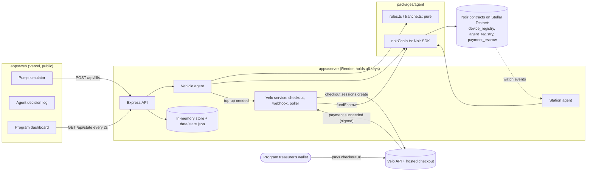

# 02 — Technical design: Pasada

Status: final for the hackathon build. Owner: the Pasada team. Read `01-product-context.md` first.

## 1. Goals and non-goals

**Goals**
1. A vehicle agent that decides, makes and requests payments using the Noir SDK on the deployed Testnet contracts.
2. A station agent that claims payments automatically.
3. A Velo top-up loop: checkout session → verified webhook (with a polling fallback) → `fundEscrow`.
4. A live one-page website that shows every decision, its reasons, and its transaction links.
5. Scenarios S1–S5 from the product context working on the deployed site.

**Non-goals:** real NFC reading, real authentication, multi-tenant programs, mainnet, persistence that
survives a redeploy (the chain is the source of truth for money; the local log is a convenience).

## 2. Architecture



The browser never holds a key and never calls Noir or Velo directly. It only talks to our server.

## 3. Repository layout (exact)

```
pasada/
├── apps/
│   ├── web/                      # @pasada/web — Vite + React live website
│   │   ├── index.html
│   │   ├── src/
│   │   │   ├── main.tsx
│   │   │   ├── App.tsx
│   │   │   ├── api.ts            # fetch wrapper, VITE_API_URL
│   │   │   ├── format.ts         # php/xlm/time/explorer-link helpers
│   │   │   ├── components/
│   │   │   │   ├── Header.tsx
│   │   │   │   ├── PumpPanel.tsx
│   │   │   │   ├── DecisionFeed.tsx
│   │   │   │   ├── DecisionCard.tsx
│   │   │   │   ├── ProgramPanel.tsx
│   │   │   │   ├── VehicleCard.tsx
│   │   │   │   ├── HeldFills.tsx
│   │   │   │   ├── TopUps.tsx
│   │   │   │   └── EventFeed.tsx
│   │   │   └── index.css
│   │   ├── .env.example
│   │   ├── package.json
│   │   ├── tsconfig.json
│   │   └── vite.config.ts
│   └── server/                   # @pasada/server — Express API, agents runtime, Velo
│       ├── src/
│       │   ├── index.ts          # boot: load env, store, start agents, listen
│       │   ├── env.ts            # reads + validates env vars
│       │   ├── app.ts            # express app, routes, CORS
│       │   ├── store.ts          # in-memory state + JSON snapshot
│       │   ├── serialize.ts      # bigint → strings, display fields
│       │   ├── routes/
│       │   │   ├── state.ts      # GET /api/state, GET /api/config, GET /api/health
│       │   │   ├── fills.ts      # POST /api/fills, held approve/reject
│       │   │   ├── admin.ts      # reset, close vehicle (P2)
│       │   │   └── veloWebhook.ts# POST /webhooks/velo (raw body)
│       │   └── velo/
│       │       ├── client.ts     # new Velo(...)
│       │       ├── topups.ts     # create checkout for a tranche, handle "paid"
│       │       └── poller.ts     # paymentIntents.retrieve fallback
│       ├── scripts/
│       │   ├── generate-keys.ts  # npm run keys
│       │   ├── setup-chain.ts    # npm run setup:chain
│       │   └── smoke.ts          # npm run smoke
│       ├── data/.gitkeep
│       ├── .env.example
│       ├── package.json
│       └── tsconfig.json
├── packages/
│   ├── agent/                    # @pasada/agent — agent logic and every Noir SDK call
│   │   ├── src/
│   │   │   ├── index.ts
│   │   │   ├── rules.ts          # pure rule engine
│   │   │   ├── tranche.ts        # pure top-up planner
│   │   │   ├── explain.ts        # human sentences for decisions
│   │   │   ├── vehicleAgent.ts   # orchestrates rules → checkPayment → authorizePayment
│   │   │   ├── stationAgent.ts   # watch payment.authorized → claim; sweeper
│   │   │   ├── chainPort.ts      # ChainPort interface (for tests)
│   │   │   ├── noirChain.ts      # ChainPort implemented with @noirx402/agent-sdk
│   │   │   ├── lock.ts           # withAccountLock
│   │   │   └── deviceHash.ts     # SHA-256 of the UID string
│   │   ├── test/
│   │   │   ├── rules.test.ts
│   │   │   ├── tranche.test.ts
│   │   │   └── vehicleAgent.test.ts   # with FakeChain
│   │   ├── package.json
│   │   └── tsconfig.json
│   └── shared/                   # @pasada/shared — types, demo config, money helpers
│       ├── src/
│       │   ├── index.ts
│       │   ├── types.ts
│       │   ├── config.ts         # program params, vehicles, stations (no secrets)
│       │   └── money.ts          # stroops ↔ php display
│       ├── package.json
│       └── tsconfig.json
├── docs/                         # these design docs, screenshots, DEVLOG.md, testnet-proof.md
├── .env.example                  # every variable from both apps, empty
├── .gitignore                    # node_modules, dist, .env, apps/server/data/*.json
├── package.json                  # workspaces root
├── tsconfig.base.json
├── vitest.config.ts              # runs packages/agent/test
├── AGENTS.md
└── README.md                     # the judging README
```

### 3.1 Package wiring (no build step for packages)

- Each package's `package.json` has `"type": "module"`, `"private": true`, and
  `"exports": { ".": "./src/index.ts" }`. The server runs on `tsx`, and Vite compiles TypeScript
  from workspace packages, so packages are consumed as source.
- `tsconfig.base.json`: `"target": "ES2022"`, `"module": "ESNext"`, `"moduleResolution": "Bundler"`,
  `"strict": true`, `"noEmit": true`, `"skipLibCheck": true`, `"esModuleInterop": true`,
  `"resolveJsonModule": true`, `"verbatimModuleSyntax": false`, `"lib": ["ES2022", "DOM"]`.
- `apps/web` imports only `@pasada/shared` (types, config, money). It must **never** import
  `@pasada/agent`, the Noir SDK, or the Velo SDK.
- Root `package.json`:

```json
{
  "name": "pasada",
  "private": true,
  "type": "module",
  "engines": { "node": ">=22.23.4" },
  "workspaces": ["apps/*", "packages/*"],
  "scripts": {
    "dev": "concurrently -n server,web -c blue,green \"npm run dev -w @pasada/server\" \"npm run dev -w @pasada/web\"",
    "build": "npm run build -w @pasada/web",
    "start": "npm run start -w @pasada/server",
    "keys": "npm run keys -w @pasada/server",
    "setup:chain": "npm run setup:chain -w @pasada/server",
    "smoke": "npm run smoke -w @pasada/server",
    "test": "vitest run",
    "typecheck": "npm run typecheck --workspaces --if-present"
  },
  "devDependencies": { "concurrently": "^9.1.0", "typescript": "~5.9.3", "vitest": "^3.2.0", "tsx": "^4.19.0", "@types/node": "^22.10.0" }
}
```

- `apps/server/package.json` scripts: `"dev": "tsx watch src/index.ts"`, `"start": "tsx src/index.ts"`,
  `"keys": "tsx scripts/generate-keys.ts"`, `"setup:chain": "tsx scripts/setup-chain.ts"`,
  `"smoke": "tsx scripts/smoke.ts"`, `"typecheck": "tsc --noEmit"`. Dependencies: `@pasada/agent`,
  `@pasada/shared` (version `"*"`), `@carts1024/velo-sdk@0.1.0-alpha.4`, `@noirx402/agent-sdk@0.3.0`,
  `@stellar/stellar-sdk@^16.0.1`, `express@^4.21.2`, `cors`, `dotenv`, `tsx`, and `@types/express@^4`, `@types/cors`.
- `packages/agent` dependencies: `@pasada/shared`, `@noirx402/agent-sdk@0.3.0`, `@stellar/stellar-sdk@^16.0.1`.

## 4. Accounts and keys

All accounts are Stellar Testnet accounts funded by Friendbot (10,000 test XLM each).

| Role | Env var | Signs | Notes |
| --- | --- | --- | --- |
| Program owner | `PROGRAM_OWNER_SECRET` | `registerDevice`, `registerAgent`, `fundEscrow`, `unlinkDevice` | Owns every jeepney card. Also the wallet you sign in to Velo with (see §12.1) |
| J1 vehicle agent | `AGENT_J1_SECRET` | `authorizePayment` for J1 | Pays its own fees (~2.3 XLM on its first tap) |
| J2 vehicle agent | `AGENT_J2_SECRET` | `authorizePayment` for J2 | |
| J3 vehicle agent | `AGENT_J3_SECRET` | `authorizePayment` for J3 | |
| S1 station | `STATION_S1_SECRET` | `claim` | Accredited |
| S2 station | `STATION_S2_SECRET` | `claim` | Accredited |
| S3 station | `STATION_S3_PUBLIC` | nothing | Not accredited; only its address is needed |
| Treasurer | none (a person's wallet) | pays the Velo checkout in the browser | Any Testnet wallet, e.g. the Noir Chrome extension funded by Friendbot |

`scripts/generate-keys.ts` (`npm run keys`):
1. Load `apps/server/.env` if present.
2. For each secret var above that is empty or missing, create `Keypair.random()`; for `STATION_S3_PUBLIC`
   create a keypair and keep only the public key.
3. Fund every new public key with `GET https://friendbot.stellar.org?addr=<G…>` (retry 3 times, 2 s apart).
   Do not fund S3; it never transacts.
4. Write the values into `apps/server/.env`, preserving every existing line and comment. Never overwrite
   a non-empty value.
5. Print each role with its public key and a Stellar Expert account link. Never print secrets.

## 5. Configuration (`packages/shared/src/config.ts`)

Non-secret, committed to git. Addresses come from env at runtime (server only).

```ts
export const PROGRAM = {
  name: 'QC Jeepney Fuel Aid (demo)',
  subsidyStroopsPerLiter: 1_000_000n,      // 0.1 XLM per liter
  phpPerXlmDemoRate: 120,                  // display only: ₱12/L ↔ 0.1 XLM/L
  weeklyCapLiters: 150,                    // real 2026 LTFRB cap per vehicle
  refillWindowMinutes: 60,                 // see rule R5
  programEndsAt: new Date('2026-12-31T15:59:59Z'), // 23:59:59 PHT
  trancheDays: 2,                          // top-up covers this many days of usage
  maxLitersPerRequest: 200,
} as const;

export const VEHICLES = [
  { id: 'J1', plate: 'NVE 1234', route: 'Cubao – Quiapo',           tankLiters: 60, tagUid: '04A1B2C3D4E501', initialEscrowStroops: 120_000_000n },
  { id: 'J2', plate: 'TXR 5678', route: 'Fairview – Commonwealth',  tankLiters: 50, tagUid: '04A1B2C3D4E502', initialEscrowStroops: 120_000_000n },
  { id: 'J3', plate: 'PUJ 9012', route: 'Novaliches – Blumentritt', tankLiters: 60, tagUid: '04A1B2C3D4E503', initialEscrowStroops:  30_000_000n },
] as const;

export const STATIONS = [
  { id: 'S1', name: 'Bituin Fuels — EDSA Cubao',   accredited: true },
  { id: 'S2', name: 'Silangan Gas — Commonwealth', accredited: true },
  { id: 'S3', name: 'Kanto Fuel Depot',            accredited: false },
] as const;
```

Derived values (compute, never hard-code):
- `perFillCapStroops(vehicle) = BigInt(vehicle.tankLiters) * PROGRAM.subsidyStroopsPerLiter` (used as the Noir `maxAmount`).
- `lowBalanceThresholdStroops(vehicle) = perFillCapStroops(vehicle)` (one full tank of subsidy).
- `deviceHash(vehicle) = sha256Hex(utf8(vehicle.tagUid))` — see §9.1.
- `ASSET = Asset.native().contractId(Networks.TESTNET)` (the native XLM token contract), computed in `packages/agent`.

## 6. Domain model (`packages/shared/src/types.ts`)

```ts
export type VehicleId = 'J1' | 'J2' | 'J3';
export type StationId = 'S1' | 'S2' | 'S3';

export type Outcome = 'APPROVED' | 'APPROVED_CAPPED' | 'HELD' | 'REFUSED' | 'FAILED';

export type ReasonCode =
  | 'OK'
  | 'UNKNOWN_VEHICLE' | 'INVALID_LITERS' | 'UNACCREDITED_STATION' | 'PROGRAM_EXPIRED'
  | 'WEEKLY_CAP_REACHED' | 'WEEKLY_CAP_PARTIAL' | 'OVER_TANK_CAPACITY'
  | 'TOO_SOON' | 'AWAITING_FUNDS'
  | 'POLICY_NO_AGENT' | 'POLICY_WRONG_AGENT' | 'POLICY_WRONG_ASSET' | 'POLICY_INVALID_AMOUNT' | 'POLICY_OVER_LIMIT'
  | 'RELEASED_BY_PROGRAM' | 'CHAIN_ERROR';

export interface RuleCheck {
  rule: 'R0' | 'R1' | 'R2' | 'R3' | 'R4' | 'R5' | 'R6' | 'C1' | 'C2';
  label: string;          // e.g. "Station is accredited"
  passed: boolean;
  detail: string;         // e.g. "Bituin Fuels — EDSA Cubao is on the program list"
}

export interface Decision {
  id: string;             // crypto.randomUUID()
  createdAt: string;      // ISO
  vehicleId: VehicleId;
  stationId: StationId;
  requestedLiters: number;
  outcome: Outcome;
  approvedLiters: number;           // 0 unless APPROVED / APPROVED_CAPPED
  amountStroops: bigint;            // 0n unless paid
  reasons: ReasonCode[];
  checks: RuleCheck[];
  explanation: string;              // one or two plain sentences, see §8.4
  authorizeTxHash?: string;
  nonce?: string;
  claimTxHash?: string;
  heldFillId?: string;
  trancheId?: string;               // top-up created because of this decision
  errorName?: string;               // NoirContractError.errorName when FAILED
  releasedFromHeldFillId?: string;  // when this decision paid a previously held fill
}

export type HeldStatus = 'NEEDS_REVIEW' | 'AWAITING_FUNDS' | 'RELEASED' | 'REJECTED';
export interface HeldFill {
  id: string; createdAt: string; vehicleId: VehicleId; stationId: StationId;
  requestedLiters: number; amountStroops: bigint;   // amount it would pay (after capping)
  reason: 'TOO_SOON' | 'AWAITING_FUNDS'; status: HeldStatus;
  decisionId: string; resolvedDecisionId?: string;
}

export type TrancheStatus = 'REQUESTED' | 'PAID' | 'FUNDED' | 'FAILED' | 'EXPIRED';
export interface Tranche {
  id: string; createdAt: string; updatedAt: string; vehicleId: VehicleId;
  status: TrancheStatus;
  amountStroops: bigint;
  rationale: string;                  // the agent's sentence, see §9.3
  plan: { dailyLiters: number; days: number; requestLiters: number; targetStroops: bigint;
          balanceStroops: bigint; heldStroops: bigint };
  paymentIntentId: string;            // Velo PaymentIntent.paymentIntentId
  veloObjectId: string;               // Velo PaymentIntent.id (store both; match either)
  checkoutUrl: string;
  receiverAddress?: string | null;
  payerAddress?: string | null;
  veloPaymentTxHash?: string;         // from the webhook, when present
  confirmedVia?: 'webhook' | 'poll';
  fundTxHash?: string;
  error?: string;
}

export interface ChainEventRecord {
  id: string; type: string; ledger: number; at: string; txHash: string;
  vehicleId?: VehicleId; stationId?: StationId; amountStroops?: bigint;
  source: 'noir' | 'velo';
}

export interface ApprovedFill { at: string; liters: number; } // history used by the rules
```

## 7. Persistence (`apps/server/src/store.ts`)

- One in-memory object: `{ decisions: Decision[], held: HeldFill[], tranches: Tranche[], events: ChainEventRecord[], processedVeloDeliveries: string[] }`.
- After every mutation, write a JSON snapshot to `${DATA_DIR}/state.json` (bigints as strings),
  debounced 500 ms. On boot, load it if present.
- Keep the newest 200 decisions and 300 events (drop older ones).
- Weekly usage and the last fill are **derived** from `decisions` (outcome `APPROVED` or `APPROVED_CAPPED`,
  `createdAt` within the last 7 days). If the server restarts on a fresh disk, weekly usage resets. That is
  acceptable for the demo; money balances always come from the chain.
- `POST /api/admin/reset` (requires `x-admin-token`) clears the store. It does not touch the chain.

## 8. The vehicle agent

### 8.1 Pipeline

`vehicleAgent.handleFill({ vehicleId, stationId, liters, now, options? })`:

1. **Rules (pure):** `evaluateFill(...)` → `refuse | hold | pay`.
2. If `refuse` → record a `REFUSED` decision. Done. No chain call.
3. If `hold` (`TOO_SOON`) → record a `HELD` decision and a `HeldFill` with status `NEEDS_REVIEW`. Done.
4. If `pay` → **C1** `chain.checkPayment({ deviceHash, agent: agentPublicKey, asset, amount, requireEscrow: true })`.
   - `ok` → go to 5.
   - `insufficient_escrow` → record `HELD` with reason `AWAITING_FUNDS` and a `HeldFill` (`AWAITING_FUNDS`),
     then call `ensureTopUp(vehicle, now)` (§9). Set `decision.trancheId`. Done.
   - `expired` → `REFUSED` with `PROGRAM_EXPIRED`.
   - any other reason `r` → `REFUSED` with `POLICY_<R uppercase>` (e.g. `over_limit` → `POLICY_OVER_LIMIT`).
5. **C2** `chain.authorizePayment({ agentSecret, deviceHash, merchant: stationPublicKey, asset, amount })`
   inside `withAccountLock(agentPublicKey)`.
   - success → record `APPROVED` (or `APPROVED_CAPPED` when the rules capped liters) with `authorizeTxHash` and `nonce`.
   - `NoirContractError` → `FAILED` with `CHAIN_ERROR` and `errorName`.
   - any other error → `FAILED` with `CHAIN_ERROR` and `errorName: 'UNKNOWN'`; log the message.
6. After a successful payment: read `getEscrowBalance(deviceHash)`; if it is below
   `lowBalanceThresholdStroops(vehicle)`, call `ensureTopUp(vehicle, now)` and set `decision.trancheId`.
7. Tell the station agent to claim for that station soon (`stationAgent.nudge(stationId)`); the watch
   loop will also catch it.

`handleFill` returns the `Decision`. It never throws to the HTTP layer.

### 8.2 Rules (`packages/agent/src/rules.ts`, pure)

Signature:

```ts
export interface EvaluateInput {
  vehicle: VehicleConfig | undefined;
  station: StationConfig | undefined;
  requestedLiters: number;
  now: Date;
  history: ApprovedFill[];          // this vehicle's approved fills, any order
  program: typeof PROGRAM;
  skipRefillWindow?: boolean;       // true when the program releases a held fill
}
export type Evaluation =
  | { kind: 'refuse'; reason: ReasonCode; checks: RuleCheck[] }
  | { kind: 'hold'; reason: 'TOO_SOON'; approvedLiters: number; amountStroops: bigint; checks: RuleCheck[] }
  | { kind: 'pay'; approvedLiters: number; amountStroops: bigint; capped: boolean; capReasons: ReasonCode[]; checks: RuleCheck[] };
export function evaluateFill(input: EvaluateInput): Evaluation;
```

Rules run **in this order**; the first `refuse` or `hold` stops evaluation. Every rule that ran adds a `RuleCheck`.

| Rule | Check | If it fails |
| --- | --- | --- |
| R0 | Vehicle exists | refuse `UNKNOWN_VEHICLE` |
| R1 | `requestedLiters` is an integer, 1 ≤ liters ≤ `maxLitersPerRequest` (200) | refuse `INVALID_LITERS` |
| R2 | Station exists **and** `accredited === true` | refuse `UNACCREDITED_STATION` |
| R3 | `now < program.programEndsAt` | refuse `PROGRAM_EXPIRED` |
| R4 | `weeklyUsed = sum(liters of history within [now − 7 days, now])`; `remaining = weeklyCapLiters − weeklyUsed`; need `remaining > 0` | refuse `WEEKLY_CAP_REACHED` |
| R5 | Refill window (skipped when `skipRefillWindow`): let `last` = most recent history entry. Fails when `last` exists **and** `now − last.at < refillWindowMinutes` **and** `last.liters + requestedLiters > vehicle.tankLiters` | hold `TOO_SOON` (still compute `approvedLiters`/`amountStroops` with R6 so a later release knows the amount) |
| R6 | Cap: `approvedLiters = min(requestedLiters, tankLiters, remaining)`. `capReasons`: add `OVER_TANK_CAPACITY` when `tankLiters < requestedLiters` and `tankLiters === approvedLiters`; add `WEEKLY_CAP_PARTIAL` when `remaining < requestedLiters` and `remaining === approvedLiters`. `capped = approvedLiters < requestedLiters` | never fails |

`amountStroops = BigInt(approvedLiters) * program.subsidyStroopsPerLiter`.

### 8.3 Required unit tests (`packages/agent/test/rules.test.ts`)

Use J1 (tank 60), `now = 2026-11-07T02:00:00Z`, empty history unless stated.

| # | Input | Expected |
| --- | --- | --- |
| 1 | J1, S1, 40 L | `pay`, 40 L, 40,000,000n, `capped=false` |
| 2 | J2 (tank 50), S2, 80 L | `pay`, 50 L, 50,000,000n, `capped=true`, `capReasons=['OVER_TANK_CAPACITY']` |
| 3 | J1, S3, 20 L | `refuse UNACCREDITED_STATION` |
| 4 | J1, S1, 0 L / 2.5 L / 201 L | `refuse INVALID_LITERS` |
| 5 | unknown vehicle | `refuse UNKNOWN_VEHICLE` |
| 6 | `now` after program end | `refuse PROGRAM_EXPIRED` |
| 7 | history 150 L within the week | `refuse WEEKLY_CAP_REACHED` |
| 8 | history 130 L this week, request 40 L | `pay`, 20 L, `capReasons=['WEEKLY_CAP_PARTIAL']` |
| 9 | history 40 L at `now − 12 min`, request 30 L | `hold TOO_SOON`, approvedLiters 30 |
| 10 | history 40 L at `now − 12 min`, request 10 L | `pay` 10 L (fits the tank) |
| 11 | history 40 L at `now − 61 min`, request 30 L | `pay` 30 L |
| 12 | same as 9 with `skipRefillWindow: true` | `pay` 30 L |
| 13 | history 8 days old 150 L, request 40 L | `pay` 40 L (outside the 7-day window) |

### 8.4 Explanations (`packages/agent/src/explain.ts`)

Plain sentences, peso first, XLM in brackets. `php(x)` formats `x` stroops with the demo rate as
`₱1,440`; `xlm(x)` as `12 XLM`. Templates:

| Outcome / reason | Sentence |
| --- | --- |
| APPROVED | `Approved {L} L at {station}. Paid {php} ({xlm}) from {plate}'s fuel aid. This week: {used}/150 L.` |
| APPROVED_CAPPED + OVER_TANK_CAPACITY | `Asked for {req} L, but {plate}'s tank holds {tank} L. Approved {L} L and paid {php} ({xlm}).` |
| APPROVED_CAPPED + WEEKLY_CAP_PARTIAL | `Only {L} L left of this week's 150 L allowance. Approved {L} L and paid {php} ({xlm}).` |
| HELD TOO_SOON | `{plate} took {last} L {mins} minutes ago. Another {req} L would overfill its {tank} L tank within an hour, so this fill is held for program review.` |
| HELD AWAITING_FUNDS | `The fuel-aid balance is {balancePhp} and this fill needs {php}. Held the fill and asked the program for a {topupPhp} top-up.` |
| REFUSED UNACCREDITED_STATION | `{station} is not an accredited station. No payment made.` |
| REFUSED WEEKLY_CAP_REACHED | `{plate} has used its 150 L allowance for this week. No payment made.` |
| REFUSED PROGRAM_EXPIRED | `The fuel-aid program has ended. No payment made.` |
| REFUSED POLICY_* | `Noir's on-chain policy refused this payment ({reason}). No payment made.` |
| FAILED | `The payment did not go through ({errorName}). No money moved; try again.` |
| Released held fill | prefix the APPROVED sentence with `Released by the program. ` or `Funds arrived. ` |

### 8.5 Releasing held fills

- `POST /api/held/:id/approve` (P1, status must be `NEEDS_REVIEW`): run `handleFill` again with
  `skipRefillWindow: true`, set `releasedFromHeldFillId`, add `RELEASED_BY_PROGRAM` to reasons, mark the
  held fill `RELEASED` with `resolvedDecisionId`.
- `POST /api/held/:id/reject` (P1): mark `REJECTED`. No chain call.
- After a top-up is funded (§9.4): for that vehicle, process `AWAITING_FUNDS` held fills oldest first,
  each by running `handleFill` again (normal rules; R5 can only fire if a fill was approved in between).
  Mark each `RELEASED` with `resolvedDecisionId`. If a fill is still short on funds it stays held (the new
  decision is HELD again and the old held fill is marked `RELEASED` → replaced by the new one; keep only one
  open held fill per original request).

## 9. Top-ups (the agent requests money)

### 9.1 Device hash

Noir's convention: `deviceHash = hex(SHA-256(UTF-8 bytes of the UID string))`, lowercase, 64 chars.
UID strings in this project are uppercase hex without separators (e.g. `04A1B2C3D4E501`).
Implement with `node:crypto` in `packages/agent/src/deviceHash.ts`:
`createHash('sha256').update(uid, 'utf8').digest('hex')`. (If Web NFC is ever added, normalize
`04:a1:…` to `04A1…` before hashing.)

### 9.2 `ensureTopUp(vehicle, now)` (in `apps/server/src/velo/topups.ts`, called through an injected callback)

1. If the vehicle already has a tranche in `REQUESTED` or `PAID`, return it (only one open top-up per vehicle).
2. Read `balance = getEscrowBalance(deviceHash)`.
3. `held = sum(amountStroops of this vehicle's AWAITING_FUNDS held fills)`.
4. `plan = planTopUp({ vehicle, history, balance, held, now, program })` (pure, §9.3).
5. `velo.checkout.sessions.create({ amount: fromStroops(plan.amountStroops), asset: 'native',
   description: 'Pasada top-up · ' + plate + ' · ' + requestLiters + ' L', successUrl: PUBLIC_WEB_URL + '/?topup=' + trancheId + '&result=success',
   cancelUrl: PUBLIC_WEB_URL + '/?topup=' + trancheId + '&result=cancel' }, { idempotencyKey: 'pasada-topup-' + trancheId })`.
6. Save the tranche with status `REQUESTED`, `paymentIntentId`, `veloObjectId` (= `id`), `checkoutUrl`,
   `receiverAddress`. Log a warning if `receiverAddress` is not the program owner's address (§12.1).
7. If Velo throws, save the tranche with status `FAILED` and `error`; the decision still records `HELD`.

### 9.3 `planTopUp` (`packages/agent/src/tranche.ts`, pure)

```
weekFills   = history within the last 7 days
dailyLiters = weekFills.length > 0
                ? ceil(sum(weekFills.liters) / max(1, days between the oldest fill and now, rounded up))
                : vehicle.tankLiters
requestLiters = clamp(dailyLiters * program.trancheDays, vehicle.tankLiters, program.weeklyCapLiters)
targetStroops = requestLiters * subsidyStroopsPerLiter
needed        = held + targetStroops − balance
amountStroops = roundUpToWholeXlm(max(needed, perFillCapStroops(vehicle)))
rationale     = "Balance is {balancePhp}. {plate} uses about {dailyLiters} L a day, so I'm asking for {requestLiters} L
                 ({targetPhp}) to cover the next {days} days[, plus {heldPhp} for the held fill]: {amountPhp} ({amountXlm})."
```

Required tests (`tranche.test.ts`): J3 with no history, balance 30,000,000n, held 40,000,000n →
`requestLiters 120`, `targetStroops 120,000,000n`, `amountStroops 130,000,000n` (13 XLM). Also: a
case where `needed` is below the per-fill cap returns the cap; rounding up 12.3 XLM → 13 XLM.

### 9.4 When the treasurer pays

Two paths lead to the same function, `onTopUpPaid(tranche, via, details)`:

- **Webhook** `POST /webhooks/velo` (raw body, see §11). On `payment.succeeded`, find the tranche whose
  `paymentIntentId` or `veloObjectId` equals `event.paymentIntent.id`.
- **Poller** (fallback, always on): every 5 s, for each tranche in `REQUESTED`,
  `velo.paymentIntents.retrieve(tranche.paymentIntentId)`. Status `paid` → `onTopUpPaid(…, 'poll')`;
  `expired`/`failed`/`cancelled` → mark `EXPIRED`/`FAILED`.

`onTopUpPaid` (guarded by a per-tranche lock; runs at most once):
1. If status is not `REQUESTED`, return.
2. Check the amount: `toStroops(paymentIntent.amount) === tranche.amountStroops`; if not, mark `FAILED` and log.
3. Set `PAID`, `confirmedVia`, `payerAddress`, `veloPaymentTxHash` (webhook `txHash` if present).
4. `chain.fundEscrow({ ownerSecret, deviceHash, token: ASSET, amount: tranche.amountStroops })` inside
   `withAccountLock(programOwnerPublicKey)`. Success → `FUNDED` with `fundTxHash`. Error → `FAILED` with `error`.
5. Add a `ChainEventRecord` (`source: 'velo'`, type `payment.succeeded`).
6. Process this vehicle's `AWAITING_FUNDS` held fills (§8.5).

## 10. The station agent (`packages/agent/src/stationAgent.ts`)

- On boot: `chain.watch({ onEvent, onError })` with no type filter (so the same watch feeds the event log).
  In `onEvent`, keep events whose `deviceHash` is one of our vehicles or whose `merchant` is one of our
  stations; map them to `ChainEventRecord`s.
- On `payment.authorized` whose merchant is S1 or S2: `nudge(stationId)`.
- `nudge(stationId)`: debounce 3 s per station, then inside `withAccountLock(stationPublicKey)`:
  `pending = getPendingBalance(station)`; if `pending > 0n`, `claim({ merchantSecret, token: ASSET })`.
  On success: set `claimTxHash` on every decision for that station that has an `authorizeTxHash` and no
  `claimTxHash`. Ignore `NoirContractError` with `errorName === 'NothingToClaim'`.
- Sweeper: every 20 s, `nudge` every accredited station (catches anything the watch missed, e.g. after a restart).

## 11. Server API (`apps/server/src/app.ts`)

Base URL: `https://<render-service>.onrender.com` in production, `http://localhost:8080` locally.
JSON everywhere except the webhook. Bigints are sent as strings. CORS allows the origins in `WEB_ORIGIN`
(comma-separated). Mount `express.raw({ type: 'application/json' })` **only** on `/webhooks/velo`, and
`express.json()` on everything else, **after** the webhook route.

| Method | Path | Body | Response |
| --- | --- | --- | --- |
| GET | `/api/health` | — | `{ ok: true, network: 'testnet', contracts: { deviceRegistry, agentRegistry, paymentEscrow }, time }` |
| GET | `/api/config` | — | `{ program, vehicles: [...with deviceHash, agentPublicKey, perFillCapStroops], stations: [...with publicKey], programOwnerPublicKey, explorerBase: 'https://stellar.expert/explorer/testnet' }` |
| GET | `/api/state` | — | see below |
| POST | `/api/fills` | `{ vehicleId, stationId, liters }` | `{ decision }` (waits for the chain; 5–20 s) |
| POST | `/api/held/:id/approve` | — | `{ decision }` (P1) |
| POST | `/api/held/:id/reject` | — | `{ held }` (P1) |
| POST | `/api/vehicles/:id/check-balance` | — | `{ tranche \| null }` — asks the agent to run `ensureTopUp` if below threshold (P1, for the demo button "Agent: check balance") |
| POST | `/webhooks/velo` | raw Velo event | `200 OK` / `400` on bad signature |
| POST | `/api/admin/reset` | header `x-admin-token` | `{ ok: true }` |
| POST | `/api/admin/vehicles/:id/close` | header `x-admin-token` | `{ hashes, escrowReturnedStroops }` (P2, `unlinkDevice`) |

`GET /api/state` response (the web polls this every 2 s):

```json
{
  "now": "2026-11-07T02:00:00.000Z",
  "vehicles": [{
    "id": "J1", "plate": "NVE 1234", "route": "Cubao – Quiapo", "tankLiters": 60,
    "escrowStroops": "80000000", "escrowXlm": "8", "escrowPhp": "₱960",
    "lowBalanceThresholdStroops": "60000000", "isLow": false,
    "weeklyUsedLiters": 40, "weeklyCapLiters": 150, "lastFillAt": "2026-11-07T01:48:00.000Z",
    "policy": { "maxAmountStroops": "60000000", "expiresAt": "2026-12-31T15:59:59.000Z", "agent": "G…" },
    "openTrancheId": null
  }],
  "stations": [{ "id": "S1", "name": "Bituin Fuels — EDSA Cubao", "accredited": true, "publicKey": "G…", "pendingStroops": "0", "claimedTodayStroops": "40000000" }],
  "decisions": [ /* newest first, max 50, serialized Decision */ ],
  "held": [ /* open first */ ],
  "tranches": [ /* newest first */ ],
  "events": [ /* newest first, max 100 */ ]
}
```

Chain reads in `/api/state` (escrow balances, policies, pending balances) are cached for 4 s so polling
does not hammer the RPC. Every serialized amount also carries `…Xlm` and `…Php` display strings.

Errors: validation errors → `400 { error: 'message' }`. Everything else in `/api/fills` comes back as a
`Decision` with outcome `FAILED`, status 200.

### 11.1 Velo webhook handler (`routes/veloWebhook.ts`)

```ts
router.post('/webhooks/velo', express.raw({ type: 'application/json' }), async (req, res) => {
  const payload = req.body.toString('utf8');
  const sig = req.headers['x-velo-signature'];
  const delivery = String(req.headers['x-velo-delivery'] ?? '');
  try {
    const event = await Velo.webhooks.verify({ payload, signature: Array.isArray(sig) ? sig[0] : sig ?? null, secret: env.VELO_WEBHOOK_SECRET });
    if (delivery && store.hasDelivery(delivery)) return res.status(200).send('duplicate');
    store.addDelivery(delivery || event.id);
    if (event.type === 'payment.succeeded') await topups.onWebhookPaid(event.paymentIntent); // matches tranche, calls onTopUpPaid
    store.addEvent({ source: 'velo', type: event.type, ... });
    return res.status(200).send('ok');
  } catch (e) {
    if (e instanceof VeloWebhookSignatureVerificationError) return res.status(400).send('bad signature');
    log.error(e); return res.status(200).send('logged'); // don't make Velo retry on our own bugs
  }
});
```

## 12. Velo integration

### 12.1 Dashboard setup (done once by a human, task T0)

1. Import `PROGRAM_OWNER_SECRET` into a browser wallet (the Noir extension or Freighter) on Testnet.
2. Sign in to `velo-build.dev` with **that** wallet and create a project "Pasada". The checkout's
   `receiverAddress` should then be the program owner, so the top-up money lands in the wallet that funds
   the escrows. If Velo shows a different receiver, continue anyway (the program wallet already has
   Friendbot XLM) and note it in `docs/DEVLOG.md`.
3. Generate a **Testnet API key** → `VELO_API_KEY`.
4. Add a webhook endpoint `https://<server>/webhooks/velo`, subscribe to `payment.succeeded`
   (and `payment.failed`), copy the signing secret → `VELO_WEBHOOK_SECRET`.
5. If checkout creation fails with an access or validation error, activate payment access for the project
   in the dashboard, or ask in Discord `#velo-integration`.
6. (P2) Register the three Noir contract IDs for contract-event monitoring, so `contract.event` webhooks
   also reach `/webhooks/velo` and show in the event feed.

### 12.2 Client (`apps/server/src/velo/client.ts`)

```ts
import { Velo } from '@carts1024/velo-sdk';
export const velo = new Velo({ apiKey: env.VELO_API_KEY, environment: 'testnet', timeoutMs: 15_000, maxRetries: 2,
  ...(env.VELO_BASE_URL ? { baseUrl: env.VELO_BASE_URL } : {}) });
```

## 13. Noir integration (`packages/agent/src/noirChain.ts`)

```ts
import { NoirAgentClient, keypairSigner, NoirContractError, type NoirEvent } from '@noirx402/agent-sdk';
import { Asset, Networks } from '@stellar/stellar-sdk';

export const ASSET = Asset.native().contractId(Networks.TESTNET);
const noir = new NoirAgentClient(env.NOIR_RPC_URL ? { rpcUrl: env.NOIR_RPC_URL } : undefined); // never pass `network`
```

| ChainPort method | Noir SDK call | Signer |
| --- | --- | --- |
| `registerDevice(ownerSecret, deviceHash, agent)` | `noir.execute(keypairSigner(owner), { kind: 'registerDevice', deviceHash, agent })` | owner |
| `registerAgent(ownerSecret, deviceHash, agent, maxAmount, expiresAt)` | `noir.execute(owner, { kind: 'registerAgent', deviceHash, agent, asset: ASSET, maxAmount, expiresAt })` | owner |
| `fundEscrow(ownerSecret, deviceHash, amount)` | `noir.execute(owner, { kind: 'fundEscrow', deviceHash, token: ASSET, amount })` | owner |
| `checkPayment(deviceHash, agent, amount)` | `noir.checkPayment({ deviceHash, agent, asset: ASSET, amount, requireEscrow: true })` | none |
| `authorizePayment(agentSecret, deviceHash, merchant, amount)` | `noir.authorizePayment({ agent: keypairSigner(agentSecret), deviceHash, merchant, asset: ASSET, amount })` → `{ hash, nonce }` | agent |
| `claim(merchantSecret)` | `noir.claim({ merchant: keypairSigner(merchantSecret), token: ASSET })` | station |
| `getEscrowBalance(deviceHash)` | `noir.getEscrowBalance(deviceHash)` | none |
| `getPendingBalance(merchant)` | `noir.getPendingBalance(merchant)` | none |
| `getPolicy(deviceHash)` | `noir.getPolicy(deviceHash)` | none |
| `getDeviceOwner(deviceHash)` | `noir.getDeviceOwner(deviceHash)` | none |
| `unlinkDevice(ownerSecret, deviceHash)` (P2) | `noir.unlinkDevice({ owner, deviceHash })` | owner |
| `watch(onEvent, onError)` | `noir.watch({ onEvent, onError })` → returns stop fn | none |

`lock.ts`: `withAccountLock(publicKey, fn)` — a `Map<string, Promise<unknown>>` chain so writes from the
same account run one at a time. Every write above goes through it.

### 13.1 `scripts/setup-chain.ts` (`npm run setup:chain`, idempotent)

For each vehicle in `VEHICLES`, in order, logging each step with its tx link:
1. `owner = getDeviceOwner(deviceHash)`. If `null` → `registerDevice`. If it is another wallet → stop with an
   error ("tag already registered to someone else; change the UID in config").
2. `policy = getPolicy(deviceHash)`. If `null`, or `policy.agent` ≠ this vehicle's agent, or `maxAmount` ≠
   `perFillCapStroops`, or `expiresAt` ≠ `programEndsAt` → `registerAgent`.
3. `balance = getEscrowBalance(deviceHash)`. If `balance < initialEscrowStroops` → `fundEscrow(initial − balance)`.
   (J3 must start at exactly 3 XLM for scenario S5. Add a `--reset-j3` flag that `defundEscrow`s J3 back to
   3 XLM using `noir.execute(owner, { kind: 'defundEscrow', deviceHash, token: ASSET, amount })`.)
4. Print a summary table and append every tx hash to `docs/testnet-proof.md` with a timestamp.

### 13.2 `scripts/smoke.ts` (`npm run smoke`)

Uses J1 and S1: `checkPayment` 0.1 XLM → `authorizePayment` 0.1 XLM → wait 6 s → `getPendingBalance(S1)`
→ `claim`. Prints both tx links and appends them to `docs/testnet-proof.md`. This is the first checkpoint
of the build: it proves the keys, the SDK and the contracts work.

## 14. Website (`apps/web`)

Single page, three columns on desktop (≥1024 px), stacked on mobile. Poll `GET /api/state` every 2 s
(pause while `document.hidden`). Load `GET /api/config` once. All amounts shown as `₱1,440 (12 XLM)`;
add a small footnote "Testnet demo rate: ₱120 = 1 XLM".

**Header:** "Pasada" wordmark, tagline "Fuel aid that only buys fuel", a "Stellar Testnet" badge, the
program name, links: GitHub repo, the three contract IDs on Stellar Expert, program owner account.

**Column 1 — Pump (the driver taps):**
- Station select (S1, S2, S3; S3 labeled "not accredited").
- Three jeepney cards to pick from: plate, route, tank size, current fuel-aid balance.
- Liters: number input (integer) plus quick chips 20 / 40 / 60 / 80.
- Big button **"Tap jeepney card"**. While the request runs, show a step list that advances on a timer
  (Reading card → Agent checking rules → Noir checkPayment → Noir authorizePayment) and is replaced by the
  result card when the response arrives. Disable the button while a request is in flight.
- Result card: outcome badge, approved liters, amount, the explanation sentence, and links.

**Column 2 — Agent decisions (newest first):** one `DecisionCard` per decision: outcome badge, plate →
station, "requested 80 L → approved 50 L", amount, explanation, a collapsible "Rules checked" list
(each `RuleCheck` with a check or cross icon **and** the words "passed"/"failed"), and links:
"Payment tx", "Station claim tx" (shows "claiming…" until `claimTxHash` exists).

**Column 3 — Program dashboard:**
- Per vehicle: escrow balance with a bar against the low-balance threshold, weekly liters used / 150,
  policy (cap per fill, expiry), open top-up status.
- **Top-ups:** each tranche with status pill (Requested → Paid → Funded), amount, the agent's rationale,
  a button **"Open Velo checkout"** (opens `checkoutUrl` in a new tab) while `REQUESTED`, and the fund tx link.
- **Held for review:** open held fills with **Approve** / **Reject** buttons (P1).
- **Stations:** pending and claimed amounts.
- **Event feed:** Noir and Velo events, newest first, with ledger/time and tx link.
- When the page loads with `?topup=…&result=success`, show a toast "Payment sent — waiting for Velo to confirm".

Outcome badge colors (always with the word): APPROVED green, APPROVED_CAPPED amber, HELD blue,
REFUSED red, FAILED gray. Explorer links: `https://stellar.expert/explorer/testnet/tx/<hash>`,
`/account/<G…>`, `/contract/<C…>`.

## 15. Environment variables

`apps/server/.env` (server reads it with `dotenv`; the host sets the same names):

| Name | Required | What it is | Where to get it |
| --- | --- | --- | --- |
| `PORT` | no (8080) | HTTP port | host sets it |
| `WEB_ORIGIN` | yes | Allowed CORS origins, comma-separated | `http://localhost:5173,https://<vercel-app>.vercel.app` |
| `PUBLIC_WEB_URL` | yes | Where Velo checkout returns to | the Vercel URL |
| `PROGRAM_OWNER_SECRET` | yes | Program owner secret key (S…) | `npm run keys` |
| `AGENT_J1_SECRET`, `AGENT_J2_SECRET`, `AGENT_J3_SECRET` | yes | Vehicle agent keys | `npm run keys` |
| `STATION_S1_SECRET`, `STATION_S2_SECRET` | yes | Accredited station keys | `npm run keys` |
| `STATION_S3_PUBLIC` | yes | Unaccredited station address (G…) | `npm run keys` |
| `VELO_API_KEY` | yes | Velo Testnet API key | velo-build.dev dashboard |
| `VELO_WEBHOOK_SECRET` | yes | Velo webhook signing secret | velo-build.dev dashboard → webhooks |
| `VELO_BASE_URL` | no | Override the Velo API origin | leave empty |
| `NOIR_RPC_URL` | no | Override the Soroban RPC URL | leave empty |
| `ADMIN_TOKEN` | yes | Protects `/api/admin/*` | any long random string |
| `DATA_DIR` | no (`./data`) | Where `state.json` is written | leave default |

`apps/web/.env`: `VITE_API_URL` (e.g. `http://localhost:8080`). Nothing else; never a secret.

`env.ts` validates every required var at boot and exits with a clear message naming the missing one.

## 16. Deployment

**Server → Render** (Web Service, Node):
- Repo root as root directory. Build command `npm ci`. Start command `npm start`.
- Env: all vars from §15, plus `NODE_VERSION=24.22.1` (or the newest 24.x Render offers that is ≥ 24.22.1;
  if Render can't, use 22.23.4+).
- Health check path `/api/health`.
- Free instances sleep after ~15 minutes idle. Before judging and before the pitch, open `/api/health`.
  If budget allows, use a paid instance (or Railway) so the station agent's watch keeps running.

**Web → Vercel:**
- Root directory: repo root. Install `npm ci`. Build `npm run build`. Output `apps/web/dist`.
- Env `VITE_API_URL=https://<render-service>.onrender.com`.

**After both are live:** set `WEB_ORIGIN` and `PUBLIC_WEB_URL` on Render to the Vercel URL, set the Velo
webhook URL to the Render URL, redeploy the server, then run S1–S5 on the live site.

## 17. Security (proportionate to a Testnet demo)

- All keys server-side only; `.env` git-ignored; `.env.example` has empty values.
- Webhooks verified against the raw body; duplicates dropped by `x-velo-delivery`.
- Admin routes require `x-admin-token`.
- `POST /api/fills` rate limit: 20 requests per minute per IP (P2; in-memory counter).
- Validate every request body (vehicle and station ids from the known lists, liters integer 1–200).

## 18. Testing

| Level | What | How |
| --- | --- | --- |
| Unit | Rules (§8.3), top-up planner (§9.3) | Vitest, written before the code |
| Unit | Vehicle agent orchestration | `FakeChain` implementing `ChainPort`: assert APPROVED path calls `checkPayment` then `authorizePayment`; `insufficient_escrow` creates a held fill and calls the top-up callback; `NoirContractError` → FAILED |
| Live | Keys, contracts, SDK | `npm run smoke` |
| End to end | S1–S5 | Manual, on localhost first, then on the deployed site; record tx hashes in `docs/testnet-proof.md` |

## 19. Risks and fallbacks

| Risk | Fallback |
| --- | --- |
| Velo webhook never arrives (URL, secret, or dashboard config) | The poller confirms payment within 5 s; the demo still works. Fix the webhook after |
| Velo checkout creation fails | Show the error on the top-up card and ask in Discord `#velo-integration`. Do not build a manual workaround |
| `receiverAddress` is not the program wallet | Continue; note it in the README ("Velo receives the top-up; the program wallet funds the escrow") |
| RPC slow or rate-limited | 4 s read cache; one chain write per account at a time; the UI shows progress |
| Testnet reset | `npm run keys` + `npm run setup:chain` rebuild everything |
| Free Render instance asleep | Hit `/api/health` before any demo |
| Velo SDK types fail to resolve (its `.d.ts` files import `./types.ts`) | `skipLibCheck: true`; if still broken, add a small local `declare module` or cast the client to `any` in `velo/client.ts` only |
